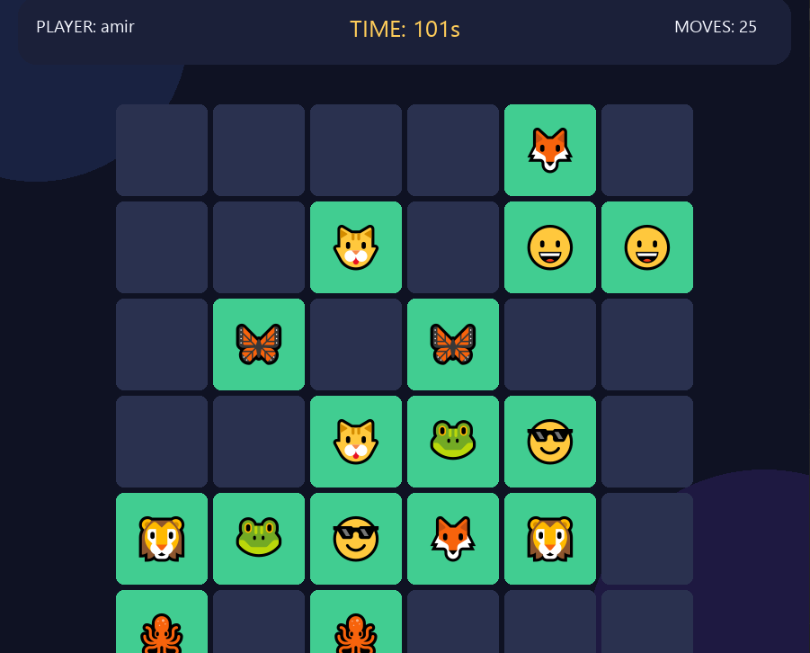

# 🎮 Python Games

A collection of fun and interactive games built with **Python** and **Pygame**.

This repository is a place for my Python game development projects, where I practice programming, improve my skills, and build different games.

---

## 🧠 Memory Match

A fun and challenging memory card game. Flip the cards, find matching pairs, and complete the board before time runs out!

## 📸 Game Preview



## 🎯 Game Modes

| Difficulty | Grid Size | Time Limit |
|---|---:|---:|
| 🟢 Easy | 4 × 4 | 90 Seconds |
| 🔵 Medium | 6 × 6 | 150 Seconds |
| 🟡 Hard | 8 × 8 | 240 Seconds |
| 🔴 Expert | 10 × 10 | 360 Seconds |

## ✨ Features

- 🃏 Four difficulty levels.
- 🎵 Different background music for each game mode.
- 🔊 Sound effects for clicks, matches, wins, and losses.
- 🏆 Leaderboard system.
- ⏱️ Countdown timer.
- 🔄 Restart option.
- 🎨 Colorful graphical interface.
- 😀 Emoji-based cards.
- 💾 Automatic leaderboard saving.

## 🕹️ How to Play

1. Choose a difficulty level.
2. Enter your player name.
3. Flip two cards to reveal their symbols.
4. Find all matching pairs.
5. Match every pair before the timer reaches zero!

## ⌨️ Controls

| Key | Action |
|---|---|
| `ESC` | Return to Main Menu |
| `R` | Restart Game |
| `Q` | Quit Game |
| Mouse | Select Cards and Buttons |

## 🛠️ Requirements

- Python 3.x
- Pygame

Install Pygame:

```bash
pip install pygame
```

## ▶️ Run the Game

Clone the repository:

```bash
git clone https://github.com/amirhoseinkhojasteh/mini-games.git
```

Run the game:

```bash
python main.py
```

## 📂 Project Structure

```text
python-games/
│
├── images/
│   └── game.png
│
├── main.py
├── README.md
└── .gitignore
```

---

**Made with ❤️ using Python and Pygame.**